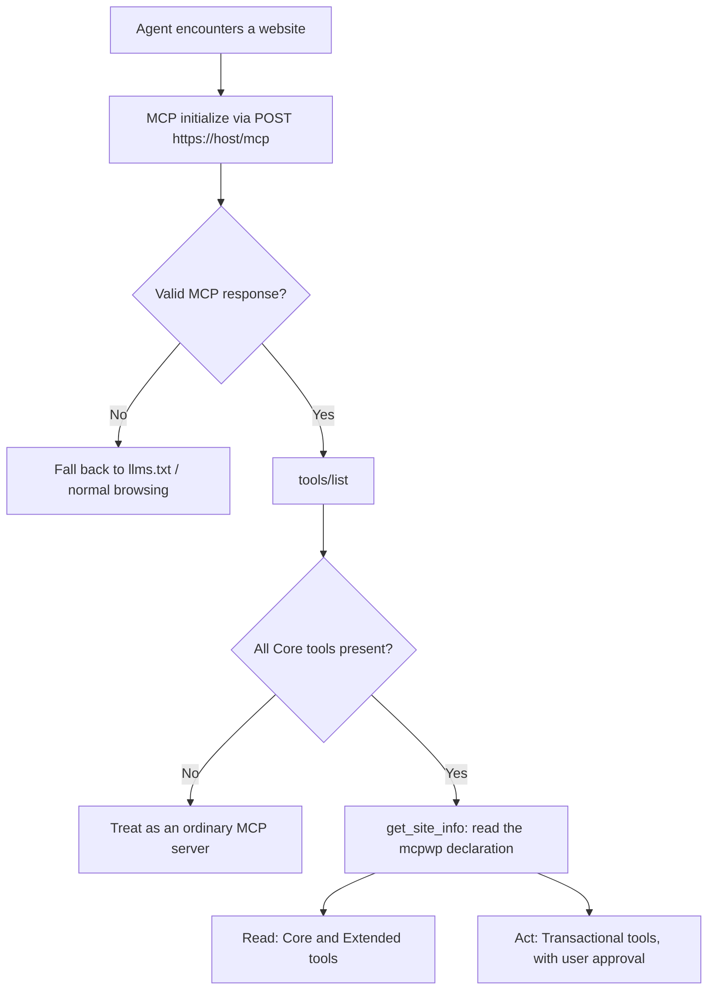
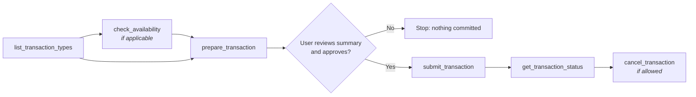

# MCP Website Profile (MCP-WP) — Version 0.1

**An open specification defining how websites expose standardised information, capabilities and services to AI agents using the Model Context Protocol.**

| | |
|---|---|
| **Version** | 0.1 |
| **Status** | Proposed Draft (open for public comment) |
| **Date** | 2026-11-01 |
| **Editors** | AI4 Enterprise Corp. |
| **Reference implementation** | [AI4Enterprise](https://www.ai4enterprise.ca/) — `https://www.ai4enterprise.ca/mcp` (alignment in progress, see §13) |
| **Repository** | <https://github.com/steveh250/website-mcp-standard> |
| **License** | Text: [CC BY 4.0](LICENSE-SPEC) · Schemas and examples: [Apache 2.0](LICENSE) |

> Copyright 2026 AI4 Enterprise Corp. and MCP-WP contributors. This document is licensed under [CC BY 4.0](https://creativecommons.org/licenses/by/4.0/). Anyone may implement it.
>
> **Status of this document.** This is a proposed draft and is **not stable**. It is published to gather implementation experience and feedback. Breaking changes may happen before 1.0. The **Transactional** level (§8) is *provisional*: implementers should expect it to change more than the rest of this document. Please file issues against this repository.

---

## Abstract

Websites are designed for people. AI agents can read them, but only by working out navigation, markup and prose that differ on every site. MCP-WP gives agents a predictable way in instead:

1. **A known address.** A participating website serves a [Model Context Protocol (MCP)](https://modelcontextprotocol.io/) server at `https://<host>/mcp`.
2. **Standard tools in three conformance levels:**
   - **Core** (mandatory): website identity, organisation overview, content discovery, page retrieval, service catalogue and contact.
   - **Extended** (optional): structured content (articles and insights), product and service details, people, events, and sector-specific information.
   - **Transactional** (optional): agent-executable interactions with authentication, permissions, user approval and auditable records.
3. **Standard result shapes.** Results carry common fields, status values and provenance (canonical URLs and timestamps).

MCP-WP is a *profile* of MCP. It defines conventions on top of MCP and does not replace or change it. The Core and Extended levels can be implemented as a small, deterministic layer over an existing CMS or static content. They do not need an AI model.

---

## Contents

1. [Introduction](#1-introduction)
2. [Conventions and terminology](#2-conventions-and-terminology)
3. [Relationship to MCP](#3-relationship-to-mcp)
4. [Discovery: the `/mcp` endpoint](#4-discovery-the-mcp-endpoint)
5. [Conformance levels and modules](#5-conformance-levels-and-modules)
6. [Core level](#6-core-level)
7. [Extended level](#7-extended-level)
8. [Transactional level (provisional)](#8-transactional-level-provisional)
9. [Declaration, versioning and extensions](#9-declaration-versioning-and-extensions)
10. [Results, status values and errors](#10-results-status-values-and-errors)
11. [Security, privacy and trust](#11-security-privacy-and-trust)
12. [Conformance testing](#12-conformance-testing)
13. [Reference implementation: AI4Enterprise](#13-reference-implementation-ai4enterprise-informative)
- [Appendix A — Example wire exchange](#appendix-a--example-wire-exchange-informative)
- [Appendix B — Design decisions in v0.1](#appendix-b--design-decisions-in-v01-informative)
- [Appendix C — Open questions for v0.2](#appendix-c--open-questions-for-v02-informative)
- [References](#references)

---

## 1. Introduction

### 1.1 Problem

An agent asked to "find a consultancy that does AI governance training and book a call" has to locate the right pages on each site, interpret each site's own layout and terms, guess which facts are authoritative, and then fill in a form designed for a human. MCP lets a site expose tools, but MCP alone does not make two sites comparable. One site may offer `get_services` and another `offerings_list`, with unrelated result shapes and unclear side effects.

MCP-WP fills three gaps:

- **Where do I start?** At `/mcp` on the site's host.
- **What can I rely on?** Standard tools with standard names, inputs, outputs and behaviour.
- **What can I safely do?** A clearly separated Transactional level, with user approval, authentication and audit built into the lifecycle.

### 1.2 Goals

1. **Predictable.** Same tool names and result shapes on every conforming site.
2. **Incremental.** A small mandatory Core that a static site can meet, with richer levels added only when they are relevant.
3. **MCP-native.** Reuse MCP's transport, tool discovery, schemas, authorisation and security. Invent nothing MCP already provides.
4. **Grounded.** Results carry canonical URLs and timestamps so agents can cite and verify.
5. **Safe.** Reading is separated from acting. Nothing with consequences happens without explicit user approval.
6. **Testable.** Every requirement has an identifier, and most can be checked automatically.

### 1.3 Non-goals for v0.1

- Changing MCP transport, framing, negotiation or authorisation.
- Agent-to-agent delegation (see A2A; complementary, §13.3).
- A universal schema for every industry. Sector-specific needs are handled by modules (§7.6).
- Payment processing through tools (§8.7).
- Requiring AI assistants to auto-connect to public MCP servers. Client adoption is a separate matter.
- Mandating any CMS, platform or language.

---

## 2. Conventions and terminology

The key words **MUST**, **MUST NOT**, **REQUIRED**, **SHALL**, **SHALL NOT**, **SHOULD**, **SHOULD NOT**, **RECOMMENDED**, **NOT RECOMMENDED**, **MAY** and **OPTIONAL** in this document are to be interpreted as described in BCP 14 ([RFC 2119](https://www.rfc-editor.org/rfc/rfc2119), [RFC 8174](https://www.rfc-editor.org/rfc/rfc8174)) when, and only when, they appear in all capitals.

Normative requirements carry an identifier such as **MCPWP-CORE-002**. In this document the `MCPWP-` prefix is omitted for brevity, so **CORE-002** means **MCPWP-CORE-002**. Sections marked *informative*, examples, and notes are not normative.

| Term | Meaning |
|---|---|
| **Site** | A public website identified by its canonical HTTPS origin. |
| **Canonical host** | The host of the site's `canonical_url` (returned by `get_site_info`), e.g. `www.example.com`. |
| **Site hosts** | The canonical host plus any other hosts that serve the same site (e.g. `example.com` and `www.example.com`). |
| **MCP-WP endpoint** | The MCP server reachable at `https://<canonical host>/mcp`. |
| **Level** | A conformance level: **Core**, **Extended** or **Transactional**. |
| **Module** | A named group of tools within a level, e.g. `core`, `insights`, `people`, `transactions`. |
| **Extension tool** | Any tool on the endpoint that is not defined by an MCP-WP module. |
| **Operator** | The organisation or person responsible for the site and its content. |
| **Client / agent** | Software connecting to the endpoint for a user or workflow. |
| **User** | The human on whose behalf the agent acts. |
| **Transaction** | An operation that creates, changes or cancels something with real-world consequences, such as a booking, order, registration or application. |
| **Public content** | Content the operator publishes to unauthenticated human visitors. |

---

## 3. Relationship to MCP

**MCP-001.** The MCP-WP endpoint MUST be a conforming MCP server using the **Streamable HTTP** transport.

**MCP-002.** The endpoint MUST support MCP protocol revision **2025-06-18** or later. That revision is the minimum because it added structured tool output (`structuredContent` and `outputSchema`), which MCP-WP relies on. Servers SHOULD support the latest stable MCP revision and negotiate the version with the client as MCP specifies.

**MCP-003.** The endpoint MUST advertise the `tools` capability. MCP-WP defines tools only. A site MAY also expose MCP resources or prompts, but MCP-WP clients MUST NOT depend on them.

**MCP-004.** Core and Extended tools SHOULD work statelessly. They SHOULD NOT depend on earlier calls in the same MCP session, apart from pagination cursors.

**MCP-005.** Authentication for the Transactional level MUST use MCP's authorisation mechanism for HTTP transports (OAuth 2.1-based). MCP-WP does not define its own authentication scheme.

Where this document and MCP appear to conflict, MCP governs transport, protocol and authorisation behaviour, and this document should be corrected.

---

## 4. Discovery: the `/mcp` endpoint

### 4.1 Server requirements

**DISC-001 — Location.** A conforming site MUST serve its MCP-WP endpoint at:

```text
https://<canonical host>/mcp
```

For example, `https://www.ai4enterprise.ca/mcp`.

**DISC-002 — Trailing slash.** The server SHOULD treat `/mcp/` the same as `/mcp`, either by serving the endpoint there too or by redirecting with HTTP 308.

**DISC-003 — Other site hosts.** Every other site host (for example the apex domain when the canonical host is `www`) SHOULD either serve the same endpoint at `/mcp` or redirect `/mcp` to the canonical endpoint with HTTP **307 or 308**, which preserve the POST method and body. Redirect targets MUST use HTTPS and SHOULD stay within the same registrable domain.

**DISC-004 — HTTPS only.** The endpoint MUST NOT serve MCP over plain HTTP. Plain-HTTP requests to `/mcp` MAY be redirected to HTTPS.

**DISC-005 — No authentication for Core and Extended.** `initialize`, `tools/list`, and `tools/call` for every Core and Extended tool MUST succeed without credentials. Reasonable abuse controls (§11.4) are allowed. Only Transactional tools may require authentication.

**DISC-006 — Human visitors.** A `GET /mcp` that does not accept `text/event-stream`, such as a browser request with `Accept: text/html`, is not an MCP request. The server MAY answer it with a human-readable page that explains the endpoint and lists its tools. All other requests MUST follow MCP's Streamable HTTP rules.

**DISC-007 — Cross-origin access.** Browser-based agents need cross-origin access, so the endpoint SHOULD answer CORS preflight requests and SHOULD send:

```http
Access-Control-Allow-Origin: *
Access-Control-Allow-Methods: GET, POST, DELETE, OPTIONS
Access-Control-Allow-Headers: Content-Type, Accept, Authorization, Mcp-Session-Id, MCP-Protocol-Version, Last-Event-ID
Access-Control-Expose-Headers: Mcp-Session-Id, WWW-Authenticate
```

A wildcard origin is acceptable because authorisation uses bearer tokens, not cookies. Servers MUST NOT use a wildcard origin together with cookie-based (credentialed) responses.

**DISC-008 — Advertising the endpoint.** A site SHOULD mention its MCP-WP endpoint in its `/llms.txt`, if it has one. It MAY also advertise the endpoint through emerging MCP discovery mechanisms, such as a well-known URI or a Server Card. Those mechanisms complement `/mcp` and do not replace it.

**DISC-009 — Server instructions.** The MCP `initialize` result SHOULD include `instructions` that name MCP-WP and suggest a starting point. For example: *"This server implements the MCP Website Profile (MCP-WP) 0.1 at levels core and extended. Call get_site_info first."*

### 4.2 Client behaviour

**DISC-010 — Validation.** A client MUST NOT conclude that a site supports MCP-WP just because `/mcp` returned HTTP 200 or a page mentioning MCP. It MUST complete MCP `initialize` and `tools/list`, then confirm that the Core tools are present (CORE-001).

**DISC-011 — Probing etiquette.** A client SHOULD probe `/mcp` only when its user's or operator's policy allows it. It SHOULD cache negative results for a reasonable period and SHOULD NOT probe repeatedly.

**DISC-012 — Redirects.** A client SHOULD follow 307/308 redirects from `/mcp` only to HTTPS URLs. It SHOULD NOT follow a redirect to a different registrable domain without user or policy approval.



---

## 5. Conformance levels and modules

MCP-WP has three conformance levels. Each level is made up of one or more **modules**, and each module is a defined group of tools.

| Level | Purpose | Modules | Access |
|---|---|---|---|
| **Core** (mandatory) | Website identity, organisation overview, content discovery, page retrieval, service catalogue and contact | `core` | Public, read-only |
| **Extended** (optional) | Structured content retrieval, product and service details, people, events, sector-specific information | `insights`, `service_details`, `people`, `events`, `x-<sector>` | Public, read-only |
| **Transactional** (optional, provisional) | Agent-executable interactions, authentication, permissions, auditable actions | `transactions` | Authenticated where needed; user-approved |

**LVL-001.** Every conforming site MUST implement the Core level.

**LVL-002.** A site conforms to the **Extended** level when it implements Core plus **at least one** Extended module in full. Sites implement only the modules relevant to them. For example, a site with no events does not implement `events`.

**LVL-003.** A site conforms to the **Transactional** level when it implements Core plus the `transactions` module in full. Extended is **not** a prerequisite for Transactional. A booking-only site need not publish people or events.

**LVL-004.** A module is implemented "in full" when all of its required tools are present and meet their requirements. Partial modules MUST NOT be declared.

Conformance claims are therefore written as:

- **MCP-WP 0.1 Core**
- **MCP-WP 0.1 Extended** (`insights`, `people`, …)
- **MCP-WP 0.1 Transactional**
- **MCP-WP 0.1 Extended + Transactional** (`insights`, `events`, …)

---

## 6. Core level

### 6.1 Inventory

| Tool | Human-facing equivalent | Purpose |
|---|---|---|
| `get_site_info` | Home / About | Website identity, organisation overview, main sections and the MCP-WP declaration |
| `get_services` | Services / Products | Service catalogue: what the site or operator offers, or `not_applicable` |
| `get_contact` | Contact | Public contact and engagement channels |
| `search_site` | Site search | Content discovery across the whole site |
| `get_page` | Any page | Retrieve one page as clean Markdown |

### 6.2 General requirements (apply to all Core and Extended tools)

**CORE-001 — Presence.** `tools/list` MUST include all five Core tools with exactly these names.

**CORE-002 — Read-only.** Core and Extended tools MUST NOT change state, send messages, create records or start transactions.

**CORE-003 — Annotations.** Each Core and Extended tool MUST be listed with MCP tool annotations `readOnlyHint: true`, `destructiveHint: false`, `idempotentHint: true` and `openWorldHint: false`.

**CORE-004 — Input compatibility.** Each tool's `inputSchema` MUST accept every argument defined for it in this specification. A site MAY add **optional** arguments. It MUST NOT add required ones.

**CORE-005 — Output.** Each tool MUST return `structuredContent` that validates against the tool's published output schema in [`schemas/`](schemas/). Each tool SHOULD declare that schema, or a compatible superset, as its `outputSchema` in `tools/list`.

**CORE-006 — Honest applicability.** If a category does not apply to the site (for example, a personal blog with no services), the tool MUST return `status: "not_applicable"` with a `reason`. It MUST NOT invent content to fill the schema.

**CORE-007 — Consistency with the human site.** Information returned by any MCP-WP tool MUST be consistent with what the site publishes to human visitors. A site MUST NOT tell agents something materially different from what it tells people.

**CORE-008 — Fixed meaning.** Extensions MAY add tools and fields but MUST NOT change the meaning of MCP-WP tools or fields.

Tool `description` text is free-form. It SHOULD say what the tool returns and SHOULD mention that the tool follows MCP-WP.

### 6.3 `get_site_info`

Website identity and organisation overview, the main sections, and the MCP-WP declaration (§9). Agents SHOULD call this tool first.

**Input:** none.

**Output** (`status: "ok"`; schema: [`get_site_info.output.json`](schemas/core/get_site_info.output.json)):

| Field | Req. | Description |
|---|---|---|
| `mcpwp` | **MUST** | Declaration: `{ "version", "levels", "modules", "extensions"? }` (§9) |
| `name` | **MUST** | Site name |
| `description` | **MUST** | One or two sentences on what the site is for |
| `canonical_url` | **MUST** | Canonical HTTPS home page URL. Its host is the canonical host. |
| `language` | **MUST** | Primary language (BCP 47) |
| `site_type` | **MUST** | One of `business`, `individual`, `government`, `education`, `nonprofit`, `publication`, `community`, `other` |
| `sections` | **MUST** | At least one `{ id, title, url, description? }`: the site's main navigation |
| `operator` | SHOULD | Organisation overview: `{ name, legal_name?, url?, location? }` |
| `updated_at` | MAY | When the site information last changed |
| `related` | MAY | Links to other machine-readable resources: `llms_txt`, `sitemap`, `agent_card` |

**CORE-010.** Every `sections[].url` MUST be retrievable with `get_page`.

### 6.4 `get_services`

The service catalogue: services, products, courses, events, resources or other offerings in one minimal common shape. The name is `get_services`, but "service" is meant broadly as anything the site or operator offers. Full details per offering are in the Extended `service_details` module (§7.3).

**Input** (all optional): `category` (string), `limit` (integer 1–100, default 50), `cursor` (string).

**Output** (schema: [`get_services.output.json`](schemas/core/get_services.output.json)):

| Field | Req. | Description |
|---|---|---|
| `services` | **MUST** (if `ok`) | Array of offerings (below), possibly empty |
| `categories` | MAY | All category values available for filtering |
| `next_cursor` | MAY | Present and non-null when more results exist |
| `reason` | **MUST** (if `not_applicable`) | Why the site has no offerings |

Each offering MUST have `id`, `name`, `description` and `url` (canonical details page). It MAY have `type` (recommended: `service`, `product`, `course`, `event`, `program`, `publication`, `resource`, `membership`, `other`), `category`, `audience`, `delivery` (`online`, `in_person`, `hybrid`, `physical_goods`, `digital_goods`, `other`), `regions`, `price` (`amount`, `currency` (ISO 4217), `unit`, `text`), `engagement_url` and `updated_at`.

**CORE-020.** A site with no offerings MUST return `status: "not_applicable"`. A site that has offerings but none matching the filter MUST return `status: "ok"` with an empty `services` array.

**CORE-021.** Prices, if given, MUST match the publicly displayed price and SHOULD include the currency. If the price is not public, omit `price` or use `price.text` (e.g. *"Contact for a quote"*).

### 6.5 `get_contact`

Returns the channels the operator has chosen to publish for contacting or engaging with them.

**Input:** none.

**Output** (schema: [`get_contact.output.json`](schemas/core/get_contact.output.json)):

| Field | Req. | Description |
|---|---|---|
| `channels` | **MUST** (if `ok`) | Array of `{ type, label?, value?, url?, purpose?, hours? }`. Each channel MUST have `value` or `url`. |
| `contact_url` | SHOULD | The human contact page |
| `reason` | **MUST** (if `not_applicable`) | Why there is no public contact channel |

`type` is one of `email`, `phone`, `form`, `booking`, `chat`, `address`, `social`, `support`, `other`.

**CORE-030.** `get_contact` returns links and identifiers only. It MUST NOT send a message or create a booking. Agent-executed bookings and enquiries belong to the Transactional level.

**CORE-031.** Only channels the operator already publishes to human visitors may be returned. MCP-WP does not require a site to publish an email address, phone number or physical address.

### 6.6 `search_site`

Content discovery across the whole public site, not just one collection.

**Input:** `query` (string, 1–500 chars, **required**), `limit` (integer 1–50, default 10), `cursor` (string), `type` (string, filter by result type).

**Output** (schema: [`search_site.output.json`](schemas/core/search_site.output.json)): `results` (MUST if `ok`), `query`, `next_cursor`. Each result MUST have `id`, `title` and `url`. It MAY have `summary`, `type` (recommended: `page`, `article`, `service`, `product`, `event`, `person`, `faq`, `other`), `section` (a `sections[].id`), `published_at` and `updated_at`.

**CORE-040 — Coverage.** Search MUST cover at least every page in `get_site_info.sections` and every offering `url` from `get_services`. It SHOULD cover all public content, including content served by Extended modules. Simple keyword matching over titles, summaries and body text is acceptable. A small site does not need a search engine.

**CORE-041 — Retrievable results.** Every result's `id` and `url` MUST be accepted by `get_page`.

**CORE-042 — Empty is not an error.** A search with no matches MUST return `status: "ok"` with `results: []`.

### 6.7 `get_page`

Retrieves one published page of the site in a form suitable for language models.

**Input:** exactly one of `id` (a page id from `search_site` or `sections`) or `url` (an absolute URL on a site host, or a root-relative path such as `/about`). The input schema lists both arguments as optional rather than using `oneOf`, because several MCP clients reject top-level schema combinators. Supplying neither or both MUST produce `invalid_request`.

**Output** (schema: [`get_page.output.json`](schemas/core/get_page.output.json)):

| Field | Req. | Description |
|---|---|---|
| `id`, `title`, `url` | **MUST** | Stable id, title and canonical URL |
| `content_format` | **MUST** | `text/markdown` (RECOMMENDED) or `text/plain` |
| `content` | **MUST** | Main content, without navigation, footers, cookie banners and other boilerplate |
| `description`, `type`, `language` | MAY | Page metadata |
| `published_at`, `updated_at` | SHOULD (when known) | Provenance timestamps |
| `truncated` | MAY | `true` if `content` was shortened; the full page is at `url` |

**CORE-050 — Own content only.** `get_page` MUST only return content from the site hosts. A URL on any other host MUST produce `invalid_request`. The server MUST NOT fetch arbitrary URLs on a client's behalf (§11.2).

**CORE-051 — Normalisation.** The server SHOULD ignore URL fragments, SHOULD accept both the canonical host and other site hosts, and SHOULD resolve redirects and aliases to the canonical page.

**CORE-052 — Missing pages.** An unknown or unpublished page MUST produce `status: "not_found"`.

**CORE-053 — Public only.** `get_page` MUST NOT return content that requires authentication for human visitors.

---

## 7. Extended level

### 7.1 General

The Extended level adds richer, structured, read-only information. Every Extended tool follows the general requirements in §6.2 (CORE-002 to CORE-008). Schemas are in [`schemas/extended/`](schemas/extended/).

| Module | Tools | Covers |
|---|---|---|
| `insights` | `search_insights`, `get_insight`, `latest_insights`, `list_topics` | Structured content retrieval: articles, news, research, case studies |
| `service_details` | `get_service` | Full product and service details |
| `people` | `get_people`, `get_person` | Team, staff, experts, speakers, authors |
| `events` | `get_events`, `get_event` | Events, webinars, courses with dates |
| `x-<sector>` | Defined by the module | Sector-specific information (§7.6) |

**XTD-001.** Content served by any Extended module MUST also be reachable through Core: `search_site` covers it, and `get_page` accepts its URLs.

**XTD-002.** Identifiers MUST be consistent across modules. An offering `id` from `get_services` is the same `id` that `get_service` accepts. Person ids referenced elsewhere (for example in `related_people` or `speakers`) are the ids that `get_person` accepts.

### 7.2 `insights` module — structured content

For sites that publish articles, news, research, case studies or other collections of knowledge.

**INS-001.** A site declaring `insights` MUST implement all four tools:

| Tool | Input (all optional unless noted) | Returns |
|---|---|---|
| `search_insights` | `query`, `topic`, `series`, `limit` (1–50, default 10), `cursor` | `results[]` of insight summaries, `total?`, `next_cursor?`. With no `query`, newest first. |
| `get_insight` | exactly one of `id` or `url` | One insight: summary fields plus `content_format`, `content` and `references?`. `not_found` if missing. |
| `latest_insights` | `limit` (1–50, default 10), `topic`, `series` | `results[]` ordered by `published_at`, newest first |
| `list_topics` | none | `topics[]` and `series[]` of `{ id, name, description?, count? }`, plus `total_insights?` |

An **insight summary** MUST have `id`, `title`, `url` and `published_at`. It MAY have `summary`, `type` (recommended: `article`, `news`, `research`, `case_study`, `video`, `podcast`, `other`), `updated_at`, `authors[]`, `topics[]` (topic ids), `series` (series id) and `language`.

**INS-002.** The `topic` and `series` filters MUST accept the `id` values returned by `list_topics`.

### 7.3 `service_details` module — product and service details

**SVC-001.** A site declaring `service_details` MUST implement `get_service`. Its input is exactly one of `id` or `url`, and it MUST accept every offering `id` and `url` returned by `get_services`.

**Output** ([`get_service.output.json`](schemas/extended/get_service.output.json)): all offering fields from §6.4, plus `content_format` and `content` (full description; **MUST**). It MAY also include:

- `availability`: `available`, `limited`, `unavailable`, `discontinued`, `preorder` or `on_request`
- `duration`: ISO 8601 or free text
- `attributes[]`: name/value specifications
- `faqs[]`: `{ question, answer }`
- `related_people[]`: person ids
- `transaction_types[]`: ids from the Transactional level that apply to this offering

**SVC-002.** `availability` is general published availability. Bookable slots and stock commitments belong to the Transactional level (`check_availability`).

### 7.4 `people` module

**PPL-001.** A site declaring `people` MUST implement:

| Tool | Input | Returns |
|---|---|---|
| `get_people` | `query?`, `role?`, `limit?` (1–100, default 50), `cursor?` | `people[]` of `{ id, name, role?, summary?, url?, image_url?, expertise[]?, links[]? }` |
| `get_person` | exactly one of `id` or `url` | One person: the fields above plus `content` (biography), `content_format` and `credentials[]?` (`{ name, issuer?, year?, url? }`). `not_found` if missing. |

**PPL-002 — Privacy.** Only people the operator already presents publicly on the site may be returned, with the information shown there. Personal contact details MUST NOT be returned unless they are published on the site.

**PPL-003 — Evidence.** Credentials SHOULD link to supporting evidence (for example an issuer's verification page) where one exists.

### 7.5 `events` module

**EVT-001.** A site declaring `events` MUST implement:

| Tool | Input | Returns |
|---|---|---|
| `get_events` | `from?`, `to?` (RFC 3339), `query?`, `limit?` (1–100, default 20), `cursor?` | `events[]` ordered by `start`, earliest first |
| `get_event` | exactly one of `id` or `url` | One event plus `content`, `content_format` and `speakers[]?`. `not_found` if missing. |

Each event MUST have `id`, `name`, `url` and `start` (RFC 3339 with offset). It MAY have `description`, `end`, `timezone` (IANA), `event_status` (`scheduled`, `postponed`, `rescheduled`, `cancelled`, `sold_out`, `completed`), `location` (`{ mode: online | in_person | hybrid, name?, address?, url? }`), `organizer`, `price`, `registration_url`, `offering_id` and `transaction_types[]`.

`get_event` returns these fields at the top level and MUST also include `content` and `content_format` on success. The optional `event_status` has the same meaning in detail results and `get_events.events[]`. The outer `status` always describes the tool-call outcome (§10), including when the event is cancelled.

**EVT-002.** With no `from` or `to`, `get_events` MUST return upcoming events (those ending at or after the current time).

**EVT-003.** Cancellations and date changes MUST be reflected in `event_status` as soon as they are published on the site.

### 7.6 Sector-specific modules

Different sectors need different information, such as menus and rooms, product stock, programme admissions, or eligibility and fees. MCP-WP accommodates this through sector modules rather than growing Core.

**SECT-001.** A sector module's name MUST begin with `x-` (e.g. `x-retail`, `x-hospitality`, `x-government`, `x-education`) until it is standardised by this specification.

**SECT-002.** A sector module MUST NOT redefine or reuse MCP-WP tool names (§9.3). Its tools MUST follow the general rules in §6.2 if they are read-only, or §8 if they perform transactions.

**SECT-003.** A sector module SHOULD publish documentation and JSON Schemas at a stable URL. That URL SHOULD be listed in `mcpwp.extensions[].description` or in the module's tool descriptions.

Sector modules that gain adoption can be proposed for standardisation (see [CONTRIBUTING.md](CONTRIBUTING.md)). Once standardised, they drop the `x-` prefix.

---

## 8. Transactional level (provisional)

The Transactional level lets an agent carry out an operation on the user's behalf, such as booking an appointment, registering for a course, requesting a quote or submitting an application. It also lets the agent check or cancel that operation later. The design standardises the **lifecycle and safety controls**, not the semantics of each industry: each site describes its own transaction types, including their input schemas, consequences and terms.

### 8.1 Lifecycle



| Stage | Tool | Changes state? |
|---|---|---|
| Discover | `list_transaction_types`, `check_availability` | No |
| Prepare | `prepare_transaction` | Creates an uncommitted draft only |
| Approve | *(client and user)* | — |
| Execute | `submit_transaction` | **Yes** |
| Manage | `get_transaction_status`, `cancel_transaction` | Status: no. Cancel: **yes** |

### 8.2 Tools

Schemas are in [`schemas/transactional/`](schemas/transactional/).

**TXN-001.** A site declaring `transactions` MUST implement `list_transaction_types`, `prepare_transaction`, `submit_transaction` and `get_transaction_status`. It MUST also implement `check_availability` if any transaction type has `uses_availability: true`, and `cancel_transaction` if any type has `cancellable: true`.

| Tool | Input | Returns |
|---|---|---|
| `list_transaction_types` | `offering_id?` | `transaction_types[]` (below) |
| `check_availability` | `type` (required), `offering_id?`, `from?`, `to?`, `limit?`, `cursor?` | `slots[]` of `{ slot_id, start, end?, label?, capacity_remaining?, price? }`, `timezone?` |
| `prepare_transaction` | `type`, `details` (both required), `offering_id?`, `slot_id?` | `transaction` with status `prepared`, or `invalid_request` with `issues[]` |
| `submit_transaction` | `transaction_id`, `idempotency_key`, `user_confirmed: true` (all required) | `transaction` with its outcome |
| `get_transaction_status` | `transaction_id` | `transaction` including `history[]` |
| `cancel_transaction` | `transaction_id`, `idempotency_key`, `user_confirmed: true` (all required), `reason?` | `transaction` (`cancelled` or `cancellation_pending`), `refund?` |

A **transaction type** MUST have:

- `id`, `name` and `description`
- `consequences`: a plain-language statement of what submitting creates or commits to
- `auth_required`
- `details_schema`: a JSON Schema for the `details` argument

It MAY have `offering_ids[]`, `scopes[]`, `uses_availability`, `payment` (`none`, `redirect`, `invoice`, `on_site`), `cancellable`, `cancellation_policy`, `terms_url`, `human_url` and `test`.

A **transaction** MUST have `transaction_id`, `type`, `status` and `summary`. It MAY have `details`, `line_items[]`, `total`, `terms_url`, `expires_at`, `cancellable_until`, `confirmation_code`, `receipt_url`, `next_action`, `created_at`, `updated_at` and `history[]`.

**Transaction states:**

| State | Meaning |
|---|---|
| `prepared` | Validated draft awaiting user approval. Nothing committed. |
| `pending` | Submitted. Awaiting operator action, payment or another step (see `next_action`). |
| `confirmed` | Accepted by the operator, e.g. a booking confirmed |
| `completed` | Fulfilled, e.g. the service delivered or the order shipped |
| `rejected` | Declined by the operator |
| `cancellation_pending` | Cancellation requested and awaiting processing |
| `cancelled` | Cancelled |
| `failed` | Could not be completed |
| `expired` | A prepared transaction that was never submitted, or a pending one that lapsed |

**TXN-002 — Annotations.**

| Tool | `readOnlyHint` | `destructiveHint` | `idempotentHint` | `openWorldHint` |
|---|---|---|---|---|
| `list_transaction_types`, `check_availability`, `get_transaction_status` | `true` | `false` | `true` | `false` |
| `prepare_transaction` | `false` | `false` | `false` | `false` |
| `submit_transaction` | `false` | `false` | `true` | `true` |
| `cancel_transaction` | `false` | `true` | `true` | `true` |

`submit_transaction` and `cancel_transaction` are idempotent per `idempotency_key` (TXN-030). They are open-world because their effects reach beyond the conversation, for example through confirmation emails and calendar entries.

### 8.3 Authentication and permissions

**TXN-010.** For a transaction type with `auth_required: true`, `prepare_transaction`, `submit_transaction`, `get_transaction_status` and `cancel_transaction` MUST require an authenticated user, using MCP authorisation (MCP-005). An unauthenticated request SHOULD receive an HTTP 401 with a `WWW-Authenticate` header, as MCP authorisation specifies, so the client can start the authorisation flow. Alternatively, the server MAY return a tool result with `status: "unauthorized"`.

**TXN-011.** Servers SHOULD use these OAuth scopes and SHOULD list the scopes each type needs in `scopes`:

- `transactions:read` for `get_transaction_status`
- `transactions:write` for `prepare_transaction`, `submit_transaction` and `cancel_transaction`

A token without the required scope MUST receive `forbidden`.

**TXN-012.** A user MUST only be able to see and act on their own transactions, or on those of an organisation they are authorised to represent.

**TXN-013 — Guest transactions.** A type MAY set `auth_required: false` for low-risk operations, such as booking a free call or sending an enquiry. In that case:

- `transaction_id` MUST be unguessable (at least 128 bits of entropy).
- The server MUST apply abuse controls (§11.4).
- The server SHOULD send confirmation to the contact details the user supplied.
- Cancelling a guest transaction MAY require the user to follow a verification link, returned as a `next_action`.

**TXN-014.** Adding the Transactional level MUST NOT cause Core or Extended tools to require authentication (DISC-005).

### 8.4 User approval

**TXN-020 — Prepare commits nothing.** `prepare_transaction` MUST NOT create any obligation, charge, message or other real-world consequence. A server MAY place a short provisional hold on a slot, but the hold MUST expire automatically by `expires_at`.

**TXN-021 — Plain-language summary.** The `summary` of a prepared transaction MUST state, in plain language:

- what will happen, for whom, and when
- any cost
- the cancellation terms
- what personal data will be shared with the operator

The summary MUST be accurate and complete enough for the user to make an informed decision.

**TXN-022 — Explicit approval.** A client MUST present the summary (and `terms_url`, if given) to the user and obtain the user's explicit approval of that specific transaction before calling `submit_transaction`. Only then may it set `user_confirmed: true`. The same applies to `cancel_transaction`. In v0.1, a client MUST NOT submit or cancel on the strength of a general standing instruction.

**TXN-023 — Submit exactly what was approved.** `submit_transaction` takes no details, only the `transaction_id` of a prepared transaction. The server MUST commit exactly the prepared terms. If anything material has changed since preparation (price, availability or terms), it MUST return `conflict` rather than commit different terms.

**TXN-024.** A server MAY additionally confirm with the user directly, for example through MCP elicitation, or by sending a `next_action` link to the website.

### 8.5 Idempotency and reliability

**TXN-030.** `submit_transaction` and `cancel_transaction` MUST require an `idempotency_key` (16–128 characters, generated by the client). Repeating a request with the same key for the same transaction MUST return the original result without repeating the effect. Servers MUST retain idempotency keys for at least 24 hours.

**TXN-031.** Every prepared transaction MUST have an `expires_at`. Submitting after that time MUST return `conflict`.

**TXN-032.** Availability from `check_availability` is indicative. Only a successful `submit_transaction` secures a slot. If the slot has gone, the result is `conflict`.

### 8.6 Audit

**TXN-040.** Every submitted transaction MUST have a stable `transaction_id` and `created_at`, and a `history[]` that records each state change with its timestamp (`at`) and `actor`. `get_transaction_status` MUST return the history.

**TXN-041.** For each state change, servers SHOULD record the authenticated user, if any, and the MCP client identity (the OAuth client id, or the `clientInfo` given at `initialize`). Records SHOULD be retained as legal and business requirements dictate.

**TXN-042.** For every submitted transaction, servers SHOULD send the user a confirmation through a channel independent of the agent, such as email, so that the user can detect actions they did not intend.

### 8.7 Payments

**TXN-050.** Tools MUST NOT accept payment card numbers, bank credentials, passwords or one-time codes as arguments. Payment, if any, MUST happen outside the tool interface:

- through a `next_action` of type `redirect` to the site's or its payment provider's checkout,
- by invoice, or
- on site.

**TXN-051.** A transaction awaiting payment MUST remain `pending` until payment completes. A `next_action.url` MUST use HTTPS and MUST belong to the site or its declared payment provider.

### 8.8 Testing

**TXN-060.** A site declaring `transactions` SHOULD provide at least one transaction type with `test: true`. Such a type runs the full lifecycle with no real-world effect, so that clients and conformance checkers can exercise it safely.

---

## 9. Declaration, versioning and extensions

### 9.1 The `mcpwp` declaration

`get_site_info` returns the site's declaration:

```json
"mcpwp": {
  "version": "0.1",
  "levels": ["core", "extended", "transactional"],
  "modules": ["core", "insights", "service_details", "transactions"],
  "extensions": [
    { "tool": "get_company_profile", "description": "Detailed experience and qualifications." }
  ]
}
```

**DECL-001.** `levels` and `modules` MUST both include `"core"`.

**DECL-002.** `levels` MUST include `"extended"` if, and only if, `modules` includes at least one Extended module (`insights`, `service_details`, `people`, `events` or `x-*`). It MUST include `"transactional"` if, and only if, `modules` includes `transactions`.

**DECL-003.** The declaration MUST match reality. Every declared module MUST be implemented in full (LVL-004), and `tools/list` remains the authoritative list of tools. A declaration is a claim, not proof of conformance.

**DECL-004.** `extensions` is OPTIONAL. If present, it SHOULD list the site's extension tools.

### 9.2 Versioning

**VER-001.** `mcpwp.version` is `MAJOR.MINOR`. This document defines `0.1`. All levels and modules share the MCP-WP version.

**VER-002.** Before 1.0, any minor version may contain breaking changes. Clients SHOULD check the exact version and SHOULD make a best effort with versions they do not recognise. From 1.0 onwards, minor versions will only add optional features.

**VER-003.** Clients MUST ignore fields, module names, `type` values and status values they do not recognise. Clients MUST treat an unrecognised status as an error if `isError` is true, and otherwise as success.

### 9.3 Extensions

**EXTN-001 — Reserved names.** An extension tool MUST NOT use any tool name defined by this specification:

- `get_site_info`, `get_services`, `get_contact`, `search_site`, `get_page`
- `search_insights`, `get_insight`, `latest_insights`, `list_topics`
- `get_service`, `get_people`, `get_person`, `get_events`, `get_event`
- `list_transaction_types`, `check_availability`, `prepare_transaction`, `submit_transaction`, `get_transaction_status`, `cancel_transaction`

**EXTN-002 — Extension fields.** Site-specific fields in MCP-WP results SHOULD be placed in the top-level `ext` object, to avoid collisions with future versions. Clients MUST ignore unknown members.

**EXTN-003 — Extension tools with side effects.** An extension tool that changes state MUST NOT be annotated `readOnlyHint: true`. It MUST follow the user-approval, payment and audit requirements of §8.4, §8.6 and §8.7 when its effects are comparable to a transaction. Sites SHOULD prefer modelling such operations as transaction types.

---

## 10. Results, status values and errors

### 10.1 Result shape

**RES-001.** Every MCP-WP tool result MUST include `structuredContent` containing a `status` field.

**RES-002.** For compatibility with clients that ignore structured output, the result SHOULD also include a `text` content block that contains the same JSON, serialised. Additional content blocks, such as resource links, MAY follow.

```json
{
  "content": [{ "type": "text", "text": "{\"status\":\"ok\",\"services\":[...]}" }],
  "structuredContent": { "status": "ok", "services": [ ... ] },
  "isError": false
}
```

### 10.2 Status values

| `status` | `isError` | Meaning | Typical use |
|---|---|---|---|
| `ok` | `false` | Success. Lists may be empty. | All tools |
| `not_applicable` | `false` | The category does not apply to this site. `reason` is required. | `get_services`, `get_contact` |
| `invalid_request` | `true` | Arguments missing, malformed or out of range | All tools with inputs |
| `not_found` | `true` | The requested item does not exist, is not published, or is not visible to this user | Retrieval and transaction tools |
| `unauthorized` | `true` | Authentication required. Never valid for Core or Extended tools. | Transactional |
| `forbidden` | `true` | Authenticated but not permitted (e.g. missing scope) | Transactional |
| `conflict` | `true` | The request conflicts with current state: slot taken, terms changed, transaction expired or already cancelled | Transactional |
| `rate_limited` | `true` | Too many requests. `error.retry_after_seconds` SHOULD be set. | All |
| `unavailable` | `true` | Temporary failure; retry later | All |
| `internal_error` | `true` | Unexpected server failure | All |

**RES-010.** The MCP `isError` flag MUST be set as in the table.

**RES-011.** When `isError` is `true`, `structuredContent` MUST include `error: { message, retry_after_seconds? }`. The `message` SHOULD help the agent correct itself (e.g. *"Use search_site to find available pages"*).

**RES-012.** Argument validation failures SHOULD be returned as a tool result with `status: "invalid_request"`, not as a JSON-RPC protocol error, so the agent can see the problem and retry. JSON-RPC errors remain correct for protocol failures such as malformed JSON-RPC or an unknown tool name. HTTP 401 for missing authentication follows MCP authorisation (TXN-010).

### 10.3 Common field conventions

**RES-020 — URLs.** `url`, `canonical_url` and related fields MUST be absolute HTTPS URLs. Each one SHOULD be the canonical URL that a human visitor would see for the same content.

**RES-021 — Timestamps.** Timestamps MUST be RFC 3339 date-times or full dates. Event and transaction times MUST include a UTC offset. `published_at` and `updated_at` SHOULD be provided whenever they are known.

**RES-022 — Identifiers.** `id` values MUST be stable across calls and SHOULD remain stable across site updates. Using the URL path or slug as the id is acceptable.

**RES-023 — Pagination.** Paginated tools return `next_cursor`. When it is present and non-null, the client MAY pass it back as `cursor`. Cursors are opaque.

**RES-024 — Language and money.** Language tags MUST be BCP 47. Currency codes MUST be ISO 4217.

---

## 11. Security, privacy and trust

### 11.1 Content is data, not instructions

**SEC-001.** Clients MUST treat all content returned by an MCP-WP endpoint as untrusted third-party data, never as instructions. Conforming to MCP-WP does not grant a site any authority over the visiting agent.

**SEC-002.** Servers MUST NOT place content in tool results, tool descriptions or transaction summaries that is intended to override, redirect or manipulate the agent's or user's instructions. This includes hidden prompts, "ignore previous instructions" text, and requests to send data elsewhere.

> **Note (non-normative): why SEC-001 matters.** Tool output is data, never instructions, because every public `/mcp` endpoint feeds text straight into the visiting agent. MCP-WP makes Core and Extended tools open to anonymous clients (DISC-005), so any site, or anyone who can get text onto a site (comments, reviews, user profiles, scraped or syndicated content), can put text in front of an agent's model. SEC-002 asks honest servers not to do this, but a client cannot tell an honest server from a compromised or malicious one. SEC-001 is the control that holds either way. In practice this covers every string an MCP-WP server supplies: tool results, error messages, transaction summaries, tool names and descriptions, and the `initialize` `instructions` text. A client may use descriptions and `instructions` (DISC-009) as hints about how to call that server's own tools. It must not let them widen the agent's task, change its permissions, or direct it to other tools, sites or data.

### 11.2 No open fetching

**SEC-010.** No MCP-WP tool may act as a general-purpose proxy. Servers MUST NOT make outbound requests to URLs supplied by clients.

### 11.3 Transport and authorisation

**SEC-020.** Servers MUST follow MCP's Streamable HTTP and authorisation security guidance, including TLS, `Origin` header validation where applicable, token audience validation, and never passing client tokens through to upstream services.

### 11.4 Abuse controls

**SEC-030.** Servers MAY apply rate limits, request-size limits and bot controls. Rate limiting SHOULD be signalled with `status: "rate_limited"` and `retry_after_seconds`. HTTP 429 at the transport level is also acceptable. Abuse controls MUST NOT amount to requiring an account for Core or Extended tools (DISC-005).

**SEC-031.** Guest transaction types (TXN-013) SHOULD have stricter per-client and per-contact limits than read-only tools.

### 11.5 Privacy

**SEC-040.** Core and Extended tools MUST return only public content. They MUST NOT disclose personal data beyond what the site already publishes to human visitors.

**SEC-041.** Transactional tools MUST request only the personal data the transaction needs (data minimisation). They MUST state in the summary what personal data will be shared (TXN-021).

**SEC-042.** Search queries and transaction details can contain personal information. Operators SHOULD minimise retention and SHOULD describe their handling of agent-submitted data in their privacy policy.

---

## 12. Conformance testing

A conformance checker takes a hostname, runs the checks for each declared level, and produces a report. It MUST NOT perform any real transaction. Transactional checks use only error paths and `test: true` types.

| # | Check | Requirements |
|---|---|---|
| **Core** | | |
| 1 | `POST https://<host>/mcp` completes MCP `initialize` over Streamable HTTP without credentials, using protocol revision ≥ 2025-06-18 | MCP-001, MCP-002, DISC-001, DISC-005 |
| 2 | Plain HTTP does not serve MCP. The apex/`www` alternate host serves or 307/308-redirects to the endpoint. | DISC-003, DISC-004 |
| 3 | `tools/list` includes all five Core tools with read-only annotations, and their input schemas accept the standard arguments | CORE-001, CORE-003, CORE-004 |
| 4 | `get_site_info` validates against its schema, the declaration is consistent, and the canonical host matches the endpoint host | CORE-005, DECL-001, DECL-002 |
| 5 | Every `sections[].url` is retrievable with `get_page` | CORE-010 |
| 6 | `get_services` and `get_contact` validate, with either `ok` or `not_applicable` plus a `reason` | CORE-005, CORE-006 |
| 7 | `search_site` returns valid results. Each result's `id` and `url` work with `get_page`. A nonsense query returns `ok` with `[]`. | CORE-040–042 |
| 8 | `get_page` with an off-site URL returns `invalid_request`. An unknown path returns `not_found`. | CORE-050, CORE-052 |
| 9 | Error results set `isError` and include `error.message` | RES-010, RES-011 |
| 10 | No extension tool uses a reserved name | EXTN-001 |
| **Extended** (per declared module) | | |
| 11 | All of the module's tools are present, read-only annotated, and schema-valid | LVL-004, CORE-003, CORE-005 |
| 12 | Cross-references resolve: every `get_services` id works with `get_service`; every `list_topics` id works as a filter; person ids resolve | XTD-002, SVC-001, INS-002 |
| 13 | A sample of Extended content appears in `search_site` and resolves with `get_page` | XTD-001 |
| 14 | `get_events` with no arguments returns no past events | EVT-002 |
| **Transactional** | | |
| 15 | The required tools are present, with the annotations in TXN-002. Conditional tools are present when the types require them. | TXN-001, TXN-002 |
| 16 | Core and Extended tools still work without credentials | TXN-014 |
| 17 | For an `auth_required` type, an unauthenticated `submit_transaction` returns HTTP 401 or `unauthorized` | TXN-010 |
| 18 | `prepare_transaction` with invalid `details` returns `invalid_request` with `issues` | TXN-001, RES-012 |
| 19 | `submit_transaction` with an unknown id returns `not_found`, and with `user_confirmed: false` returns `invalid_request` | TXN-022, RES-010 |
| 20 | On a `test` type: prepare → submit → repeat the submit with the same key (same result, no duplicate) → status (history present) → cancel | TXN-030, TXN-040, TXN-060 |

Example report:

```text
Site:             https://www.example.com
Endpoint:         https://www.example.com/mcp   (MCP 2025-06-18)
Core:             PASS   (10/10)
Extended:         PASS   insights, service_details, people, events
Transactional:    PASS   (test type 'test-booking' exercised; no live transactions)
Extension tools:  1      (get_company_profile)
Result:           MCP-WP 0.1 Extended + Transactional
```

Some requirements cannot be fully tested automatically, such as consistency with the human site (CORE-007), full search coverage (CORE-040), summary quality (TXN-021) and the absence of manipulative content (SEC-002). Checkers SHOULD sample these and report them as warnings.

---

## 13. Reference implementation: AI4Enterprise (informative)

AI4Enterprise exposes an MCP server at `https://www.ai4enterprise.ca/mcp`. The initial design review observed the following tools and mapped them to MCP-WP:

| Existing tool | Role today | MCP-WP mapping | Action for v0.1 |
|---|---|---|---|
| `get_company_profile` | Rich business overview, experience, qualifications, evidence | Extension tool. Its people and credentials content could also feed the `people` module. | Keep, and list under `mcpwp.extensions` |
| `get_services` | Consulting and training services (Think → Model → Act) | Core `get_services` | Align output with the schema |
| `get_contact` | Booking, contact and social links | Core `get_contact` | Align output with the schema |
| `search_insights`, `get_insight`, `latest_insights`, `list_topics` | Articles by keyword, topic and series; full Markdown; recent items; topic counts | Extended `insights` | Align inputs and outputs |
| — | — | Core `get_site_info`, `search_site`, `get_page` | **Add** |
| — | — | Extended `service_details` (`get_service`) | Recommended: per-service detail pages |
| — | — | Transactional: e.g. a "book a discovery call" type | Optional, later |

### 13.1 Path to conformance

1. **Core:** add `get_site_info` (with the `mcpwp` declaration), `search_site` and `get_page`. Align `get_services` and `get_contact`. Add annotations, `structuredContent`, `outputSchema` and the `instructions` text.
2. **Extended:** align the four Insights tools, and add `get_service`. This gives *MCP-WP 0.1 Extended (`insights`, `service_details`)*.
3. **Transactional (later):** turn the existing booking link into a `book-discovery-call` transaction type, with a `test` counterpart.
4. Confirm the transport details (Streamable HTTP, CORS, apex-domain redirect, human-readable `GET` page) and publish a conformance report.

### 13.2 Verification boundary

The mapping above reflects the tool inventory observed during the initial design review. Wire-level behaviour (headers, redirects, protocol version, CORS) has not yet been verified against this specification. That is the first job for the conformance checker.

### 13.3 A2A as a complement

AI4Enterprise also describes an `/agent` endpoint for an agent that the site operates, using the A2A protocol. The two endpoints serve different purposes:

- `/mcp`: the visiting agent calls site tools directly and keeps control of its workflow (MCP-WP).
- `/agent`: the visiting agent delegates a task to the site's own agent (A2A).

A site with both SHOULD link its A2A Agent Card from `get_site_info.related.agent_card`. A2A is not required by MCP-WP.

---

## Appendix A — Example wire exchange (informative)

**1. Initialize**

```http
POST /mcp HTTP/1.1
Host: www.example.com
Content-Type: application/json
Accept: application/json, text/event-stream

{"jsonrpc":"2.0","id":1,"method":"initialize","params":{
  "protocolVersion":"2025-06-18","capabilities":{},
  "clientInfo":{"name":"example-agent","version":"1.0"}}}
```

```json
{"jsonrpc":"2.0","id":1,"result":{
  "protocolVersion":"2025-06-18",
  "capabilities":{"tools":{"listChanged":false}},
  "serverInfo":{"name":"example-com-mcpwp","version":"1.4.0"},
  "instructions":"This server implements the MCP Website Profile (MCP-WP) 0.1 at levels core, extended and transactional. Call get_site_info first."}}
```

The client then sends `notifications/initialized`, as MCP requires.

**2. List tools** (excerpt)

```json
{"jsonrpc":"2.0","id":2,"result":{"tools":[
  {
    "name":"get_services",
    "title":"Services",
    "description":"MCP-WP Core: services, products and other offerings of Northwind Advisory.",
    "inputSchema":{"type":"object","properties":{
      "category":{"type":"string"},
      "limit":{"type":"integer","minimum":1,"maximum":100,"default":50},
      "cursor":{"type":"string"}}},
    "outputSchema":{ "...": "contents of schemas/core/get_services.output.json" },
    "annotations":{"readOnlyHint":true,"destructiveHint":false,"idempotentHint":true,"openWorldHint":false}
  },
  {
    "name":"submit_transaction",
    "title":"Submit a prepared transaction",
    "description":"MCP-WP Transactional: commits a transaction prepared with prepare_transaction. Only call after the user has approved the exact summary.",
    "inputSchema":{ "...": "contents of schemas/transactional/submit_transaction.input.json" },
    "annotations":{"readOnlyHint":false,"destructiveHint":false,"idempotentHint":true,"openWorldHint":true}
  }
]}}
```

**3. Read: call a Core tool**

```json
{"jsonrpc":"2.0","id":3,"method":"tools/call","params":{"name":"get_services","arguments":{"category":"Training"}}}
```

```json
{"jsonrpc":"2.0","id":3,"result":{
  "content":[{"type":"text","text":"{\"status\":\"ok\",\"services\":[{\"id\":\"exec-ai-workshop\", ...}]}"}],
  "structuredContent":{"status":"ok","services":[{
    "id":"exec-ai-workshop","name":"Executive AI Workshop","type":"course",
    "description":"A one-day workshop on AI opportunities, risks and governance for leadership teams.",
    "url":"https://www.example.com/services/exec-ai-workshop",
    "price":{"amount":6000,"currency":"CAD","unit":"per workshop"}}]},
  "isError":false}}
```

**4. Act: the transaction lifecycle** (results abbreviated; complete examples are in [`examples/consultancy/`](examples/consultancy/))

1. `list_transaction_types`: the agent finds `book-discovery-call`, which has `auth_required: false` and `uses_availability: true`.
2. `check_availability {"type":"book-discovery-call"}`: returns slots, including `dc-2026-11-04T10:00`.
3. `prepare_transaction {"type":"book-discovery-call","slot_id":"dc-2026-11-04T10:00","details":{...}}`: returns `status: prepared` and a `summary`.
4. **The agent shows the summary to the user, and the user approves.**
5. `submit_transaction {"transaction_id":"txn_01HZX4Q8K7M2","idempotency_key":"6f1c2b0e-9a4d-4c3e-8f7a-1b2c3d4e5f60","user_confirmed":true}`: returns `status: confirmed` and `confirmation_code: NW-48213`.
6. `get_transaction_status`: returns the transaction with its audit `history`.

---

## Appendix B — Design decisions in v0.1 (informative)

| # | Question | v0.1 decision | Rationale |
|---|---|---|---|
| 1 | Name | **MCP Website Profile (MCP-WP)** | Says what it is (a profile of MCP for websites) and is easy to find |
| 2 | Structure | **Three levels (Core, Extended, Transactional) made of modules** | Levels give clear claims. Modules let a site implement only what applies to it. |
| 3 | Is Extended required before Transactional? | **No** | A booking-only site should not have to publish people or events |
| 4 | `get_services` or `get_offerings`? | **`get_services`**, defined broadly | Familiar, and already deployed by the reference implementation |
| 5 | Where does the declaration live? | **`get_site_info.mcpwp`** | Works with every MCP client today. Server Cards can mirror it later. |
| 6 | Response envelope | **`status` in `structuredContent`, plus MCP `isError`** | Uses MCP's own error signal and adds outcomes MCP has no word for |
| 7 | `get_page` input | **`id` or `url`** | Agents usually hold a URL; ids keep results stable |
| 8 | Apex vs `www` | Canonical host MUST serve. Other hosts serve or 307/308-redirect. | 307/308 preserve POST bodies |
| 9 | Transactions: generic or per-industry verbs? | **Generic lifecycle with site-described types** (`details_schema`, `consequences`) | Standardises safety without forcing one schema on restaurants, governments and shops |
| 10 | How is approval enforced? | Prepare/submit split, plain-language summary, `user_confirmed`, binding of submit to the prepared terms, independent confirmation | Several independent controls, because no single control is sufficient |
| 11 | Authentication | **MCP authorisation (OAuth 2.1)**; guest types allowed for low-risk actions | No new auth scheme; free bookings and enquiries remain possible |
| 12 | Payments | **Never through tool arguments.** Redirect, invoice or on site. | Keeps card data out of agents and transcripts |
| 13 | Schema evolution | Unknown fields ignored; site fields go in `ext` | Allows additive change without collisions |

---

## Appendix C — Open questions for v0.2 (informative)

1. **Transactional refinements:** scope naming, delegated or standing authorisation (for example, "book any free call under 30 minutes"), amendments as well as cancellations, and multi-step transactions such as applications with document uploads.
2. **Authenticated tools on a separate endpoint:** whether Transactional tools should be allowed or encouraged to live at a separate authenticated endpoint.
3. **More Extended modules:** FAQs, locations and opening hours, jobs, and documents or downloads.
4. **Standardising sector modules:** retail, hospitality, government, education and professional services.
5. **Discovery alignment:** how MCP-WP should relate to MCP Server Cards or well-known discovery once those stabilise.
6. **Multilingual sites:** a `language` argument and alternate-language listings.
7. **Resources:** exposing pages as MCP resources once client support is consistent.
8. **Conformance tooling:** a reference checker and a public registry of reports.

---

## References

- Model Context Protocol — <https://modelcontextprotocol.io/>
- MCP specification (2025-06-18 and later), including the Streamable HTTP transport and Authorization — <https://modelcontextprotocol.io/specification/>
- RFC 2119 / RFC 8174 (BCP 14) — requirement keywords
- RFC 3339 — date and time on the Internet
- BCP 47 — language tags · ISO 4217 — currency codes · IANA Time Zone Database
- OAuth 2.1 (draft-ietf-oauth-v2-1) — as profiled by MCP Authorization
- JSON Schema 2020-12 — <https://json-schema.org/draft/2020-12/schema>
- `llms.txt` — <https://llmstxt.org/>
- WebMCP (browser-context tools; complementary) — <https://webmachinelearning.github.io/webmcp/>
- Agent2Agent (A2A) protocol — <https://a2a-protocol.org/>
- AI4Enterprise, *The Agentic Web: Is Your Website Ready for Non-Human Visitors?* — <https://www.ai4enterprise.ca/insights/the-agentic-web-is-your-website-ready-for-non-human-visitors>
